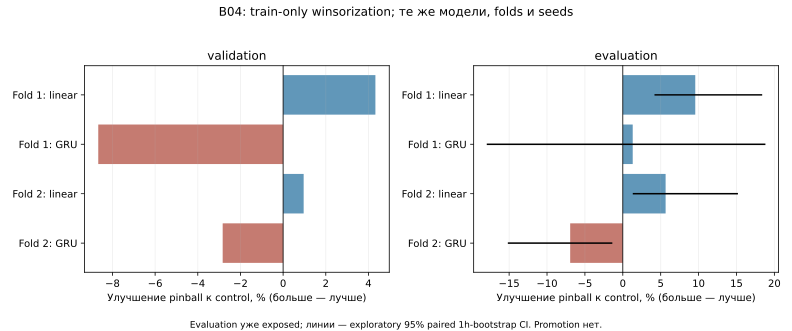

# B04 — доступность источника и train-only normalization

**Итог:** collector-only job активирован в исходном envelope, training выключен.
Linear-winsor прошёл validation criterion для будущего shadow experiment; для GRU
этот preprocessing отклонён. Champion empirical не менялся.

## План до новых market GET и fits — 2026-10-04

B03 принят. Его отрицательное activation решение и все STOP остаются неизменными.
B04 разделяет две независимые задачи: корректно учитывать отсутствие данных в
collector-only режиме и проверить чувствительность прежних моделей к хвостам features.
D43/F01/holdout, CPMM, raw, targets, model000000 и champion не меняются.

Offline audit использует sealed B03 snapshot01 и raw manifests: происхождение самых
больших |z|, OHLCV constraints, cross-capture revisions, duplicate conflicts, gaps,
receipt/event times. Никакие extreme bars не удаляются на основании полученного loss.
Официальный GeckoTerminal swagger: beta, cache1min, около10calls/min, параметр
include_empty_intervals включает интервалы без trade data. Из отсутствия bars нельзя
вывести доказанное отсутствие торгов. Данные provider не становятся coherent execution.

Normalization experiment: неизменный B03 dataset и два full-train chronological folds,
эмпирический baseline, linear/GRU, seeds7/19, width16/context8,10epochs/CPU1. Два arms:
identity (контроль) и winsorization каждого непрерывного канала по train-only q01/q99,
затем прежний train mean/std scaler. Binary channels past_positive_fraction/zero_volume
не winsorize; None/masks/age/targets не менять. Degenerate quantile span: оставить канал
как есть и явно записать. Нет подбора percentile/seed/feature subset после результатов.
16 neural fits, общий hard600s; per-fit200s, no retry after failed fit. Control checkpoints
сравнить с B03 для проверки эквивалентности. Selection по validation; только если
среднее relative improvement≥1% и ни один fold validation не хуже >1%, arm заслуживает
дальнейшего будущего shadow experiment. Сейчас никакого promotion независимо от loss.
Evaluation диагностический, уже exposed B03; paired1h bootstrap и horizons/seeds отдельно.
Transform сохранять и проверять при inference, fit только по unique train frames.

Collector-only candidate — новый root/runtime/решение, не исправление B03 результата.
Прежние 12 pools в denominator, original expiry2026-10-07T00:30:23.405597Z,
12000 shared GET ceiling (135 уже debited), paid0, sequential≥12s/GET,240s/cycle,
5min due-only, no catchup, schema whole-response quarantine, q≥4 global STOP,
auth/429 immediate STOP,2 consecutive transport failures STOP, hash/clock fatal.
Импортировать quarantine state и пробные бюджеты/next_due, не обнулять их при restart.
Training полностью отключён. Старый paired empirical/linear/GRU shadow допускается
только по прежним actual availability и ≤300s freshness, без использования B04 fits.

Новый operational criterion проверяет пригодность к записи observations/missingness,
а не достаточность fresh forecast universe: два bounded due cycles, все12dispositions
учтены, HTTP/semantic/integrity errors классифицированы, valid captures сохраняются,
не менее одного valid capture, global stop не сработал. Fresh counts публикуются, но
не являются activation gate этого collector-only режима. Это новая ограниченная цель,
не снижение B03≥9 для допуска training. При6 последовательных cycles без продвижения
nominal close хотя бы одного valid pool — STOP (причина unknown, не «рынок неактивен»).
Crash/failed cycle не сбрасывает stagnation/failure debt. Нет скрытых exclusion.

Новых market GET в qualification≤24 (два cycles), после ошибки нет третьей попытки
candidate. До GET — fixtures/recorded audit и точный source/config/import binding.
После двух успешных cycles — отдельное review/activation artifact с exact cycle seals,
runtime/plist/expiry/budget pins, затем разрешён install отдельного LaunchAgent в рамках
автономного Brain Development. Если критерии не пройдут — STOP, без нового candidate
в этом этапе. Дополнительные diagnostic market endpoints в B04 не требуются.

Validation: train-only leakage/missingness/transform replay, record lineage/duplicates,
scheduler/stagnation/failure/probe inheritance, fixtures, bounded live, installed wheel
inference/scoring reproduction. Memory Bank и Git обновить; raw/weights вне Git.

## Результат — 2026-10-04

**Collector-only режим активирован; automatic training отключён.** Новый контракт B04
прошёл две bounded qualification фазы. Отрицательное решение B03 не пересмотрено:
допуск к сбору observations/missingness не означает достаточный fresh universe для
исследовательского результата или разрешение model promotion.

План `2d057b7`, audit/ablation `e57ad03`, runtime `4e82f90`, operational tooling
`826c78c`. Исходные raw, old STOP, F01/D43 и reserved holdout не изменены/не раскрыты.

### Что установил аудит

Все три ambiguous captures B03 (000088,000101,000129) содержат один duplicate timestamp,
в котором отличается только open. Выбрать «правильный» open из этих ответов нельзя;
целые ответы остаются исключёнными. 24 tail examples относятся к 12 уникальным candles.
Большой z-score не оказался вычислительной ошибкой: `ChhuEYyL…:1790985600` содержит
open≈0,1710, close≈0,1731 и low≈0,00004928. Этот extreme low действительно записан в raw,
но представлен одной capture version и не подтверждён независимым on-chain evidence.
Ни одна свеча не удалена по её влиянию на model loss.

Официальный [GeckoTerminal swagger](https://api.geckoterminal.com/docs/v2/swagger.json)
по состоянию на проверку описывает beta API, minute cache, ориентировочный limit около
10 calls/min и `include_empty_intervals` для интервалов без торгов. Это позволяет
различать valid-stale и fresh responses, но не доказывает причину каждого missing bar.
У двух stale pools inactivity остаётся **unknown**. Дополнительных market endpoints
для её «подтверждения» в B04 не запрашивали.

### Normalization ablation

16 development neural fits,59,09s при hard600s,CPU1. Восемь контрольных checkpoints
**tensor-exact** с соответствующими B03 full-train fits. Изменялся только preprocessing:
train q01/q99 clipping, затем прежняя mean/std стандартизация. Raw/labels, missing masks,
age channel и membership сохранены. `past_positive_fraction` — bounded fraction,
а не бинарная величина; как и `zero_volume`, она оставлена без clipping по плану.

Validation improvement winsorization относительно той же модели без clipping:

| Модель | Fold1 | Fold2 | Решение по заранее заданному validation criterion |
|---|---:|---:|---|
| Linear | +4,33% | +0,96% | Кандидат для отдельного future shadow experiment |
| GRU | −8,67% | −2,83% | Не продолжать этот preprocessing для GRU |

Средний linear improvement2,64%; ни один validation fold не ухудшился. Это допуск
к дальнейшему эксперименту, не назначение champion. Empirical всё ещё лучше linear
по validation и evaluation обоих folds. Выбранный B01 champion empirical сохранён.

Диагностический evaluation pool-macro pinball:

| Fold | Empirical | Linear control | Linear winsor | GRU control | GRU winsor |
|---|---:|---:|---:|---:|---:|
| 1 | 0,030028 | 0,033601 | 0,030388 | 0,030428 | 0,030030 |
| 2 | 0,027408 | 0,029245 | 0,027593 | 0,025534 | 0,027306 |

Linear evaluation improvement9,56%/5,65%; exploratory paired1h-bootstrap CI
[4,28%;18,29%]/[1,41%;15,09%]. GRU +1,31%/−6,94%; ухудшение второго fold CI
[−15,07%;−1,48%]. Evaluation уже exposed в B03, folds зависимы, multiplicity correction
нет: эти CI не confirmatory evidence. Percentiles/seeds после просмотра не менялись.
Clipping снизил max evaluation |z| с201,83/1425,58 до5,08/5,54, но это **не равнозначно
улучшению модели** — GRU validation ухудшился. Все checkpoints и неудачные arms сохранены.

### Live qualification и activation

Два completed cycles:1791103200 и1791103500,99,54s/99,14s. Каждый сделал9GET, сохранил
12 dispositions:7fresh,2valid-stale,3quarantine-skipped. Event time продвинулся у7пулов,
stagnant debt0. Provider/schema failures0, recovery probes0; budgets/next_probe_ns
унаследованы без reset. Перед второй фазой ранний due preflight дал AssertionError
**до сети/резервирования**; лог сохранён, фактически completed market cycles ровно2.

Отдельное reviewed решение `work/brain-b04/activation-review.json` разрешило только
collector-only job. Immutable receipt связывает root/runtime/plist и оба cycle seals.
`ai.memecoin.brain.b04` установлен и loaded; первая service invocation вернула
`already_reserved` без дублирования GET. Training branch физически отсутствует;
никакие B04 weights не добавлены в model registry. Работает старый paired shadow
empirical/linear/GRU model000000 при неизменном freshness/actual availability gate.

Runtime pin:
`f248c0305d81f684db7954d1c914c335c01c2ab0f9312d10ecc593ab6d2d183e`.
Root `/Users/root1/Desktop/memecoin-ai/work/brain-b04/prospective01`.
На activation:18 новых market GET,153/12000 общего debit, paid/Alchemy/QuickNode/trades0.
Expiry **2026-10-07T00:30:23.405597Z**, не продлён. ≥12s/GET,5min due-only, no catchup,
240s hard cycle, q≥4/source/auth/rate/transport/integrity stops сохранены. Новый6cycle
no-progress STOP не трактует отсутствие продвижения как доказанное отсутствие торгов.
Нужны awake Mac/GUI login/network; наблюдались AC Power100%, настройки питания не менялись.
Реального hour-spaced quarantine release пока нет — он проверен на fixtures.

### Snapshot и проверки

Sealed `work/brain-b04/snapshot01` cutoff **2026-10-04T08:47:30.797927Z**, до background
activation:15287unique bars (+50),12pools,11/12 calendar coverage полное.98revision
observations/79keys. По-прежнему лишь три receipt UTC-часа одного дня, не многодневный
online corpus. После activation новые observations идут отдельно от этого snapshot.

Shadow198forecasts:171scored,6censored,21pending; recovery_scoring0. ДваUTC-hour blocks,
поэтому CIнет. Empirical/GRU/linear pool-macro pinball0,007418/0,008643/0,015252;
GRUхужеempirical16,5%. Это **старые** модели на новых future observations после maturity,
а не оценка новых normalization weights. Никакого edge/исполняемого PnL claim.

10 новых substantive tests,557base/6optional skips,583combined; Ruff/format/mypy
существующегоstrict scope,smoke/build. Fixtures проверяют future-feature/label isolation,
unique-train fitting, raw/missingness preservation, checkpoint/transform replay, inherited
probe debt, sixcycle stop, training prohibition и exact activation/import bindings.
Installed wheel воспроизвёл transform/weights→predictions/metrics/bootstrap и новый
raw→mature shadow **exact**, без дополнительных fits/сети. Frozen D50/B03 проверены.

**Следующий B05:** оставить frozen collector накапливать prospective часы/дни; проверить
его stop/coverage/revision/quarantine status. Подготовить заранее ограниченное paired
future shadow испытание linear-winsor challenger с train cutoff до будущих observations,
не менять empirical champion и не выбирать архитектуру по старому exposed evaluation.
Для GRU этот clipping не продолжать; более сложный backbone evidence не оправдан.
Execution costs/timing и F01 остаются отдельными от price-return Brain результатами.

[Evidence](evidence/brain-availability-normalization-2026-10-04.json).
Read-only status: `.venv/bin/python -B tools/brain_status.py --root work/brain-b04/prospective01`.
Остановка: создать `work/brain-b04/prospective01/STOP`; не удалять STOP для повторного запуска.

Дополнение handoff08:53:37UTC: первый автономный cycle1791103800 completed107,34s,
STOP отсутствует, общийdebit162 (B04 всего27GET, из них18qualification+9background).
Status212forecasts/178scored/6censored/28pending. Это operational metadata после sealed
snapshot, не замена его scoring report. Артефакт `work/brain-b04/status-handoff-02.json`.
