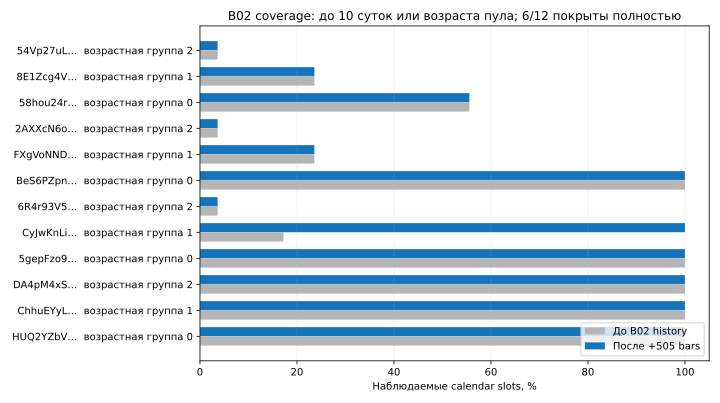
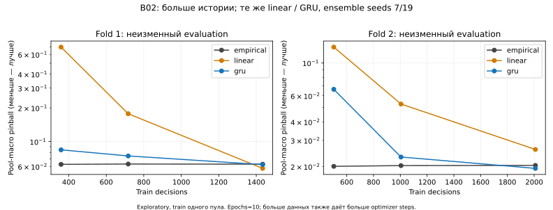

# B02 — качество и масштаб данных Brain Development

## План до дополнительного сбора и обучения — 2026-10-04

B01 принят; Brain не ожидает F01. Цель B02 — coverage существующих 12 пулов,
revision/sampling audit, learning curves и paired matured shadow, без новых backbone,
торговли или изменения D43/F01/holdout. B01 runtime/config/universe/model остаются frozen.

Historical acquisition — отдельный append-only root, тот же keyless GeckoTerminal
Solana USD base-token OHLCV/5min/include_empty_intervals=false. Целевая глубина до
10 суток перед anchor начала B02, но не ранее nominal creation bar. Для каждого пула
запрашивать назад от первого имеющегося бара; максимум 24 новых GET/30 минут, до 1000
баров/ответ, paid0. Это дополнение к B01, не сброс его quota: совокупный ceiling12000
requests сохраняется через зарезервированный debit24. B01 не редактировать; B02 прекращает
дополнительный сбор, если total attempts B01+B02≥12000. Для оставшегося B01 budget
операционный резерв24 проверяется заранее против оставшегося календарного ceiling.
В случае невозможности доказать совместимость — новые запросы не начинать.

Shared B01 acquisition lock, только свободная часть текущего уже успешно завершённого
B01 cycle; не менее12s между запросами любого lane, последующее удержание lock12s,
не начинать менее35s до следующей5min границы. Первый HTTP/schema failure или crash
закрывает B02 acquisition, без retry/нового root для обхода бюджета. Уважать B01 STOP,
expiry,401/403/429 cooldown и source bounds, free floor4GiB, B02 root cap256MiB. Пробелы
и недобранные pools сохранять; отсутствие bars не доказывает отсутствие торговли.
Официальная [OpenAPI](https://api.geckoterminal.com/docs/v2/swagger.json): beta, cache1min,
приблизительно10requests/min, before_timestamp, максимум1000rows. Public лимит не SLA.

Merge по earliest actual available_ns, immutable raw/capture SHA, first-observed versions
из B01+B02. Новая история не меняет прошлую online availability или B01 predictions.
Проверять unique pool/time, duplicates/revisions и later receipt; не переписывать data.
Audit: coverage относительно target interval/creation, gaps, event/receipt UTC bins,
число пулов/age/DEX, концентрация rows, revision magnitudes/unique keys, feature/target
support и missingness. Current-ranked universe имеет survivorship bias, deaths/unseen
не известны. Не объявлять bars finalized coherent execution или calibrated costs.

Learning curves: immutable merged dataset, фиксированные global chronological folds
по unlabelled unique decision times: train/validation/evaluation boundaries50/65/80%
и70/85/100%. На каждом fold train — последние25/50/100% его train unique times, nested;
validation/evaluation membership одинаково для трёх размеров. Whole decision maturity
purge на каждой границе; только полные labels; train-only scaler на subset. Historical
retrieval causal cutoff отдельно от retrospective event-time folds; online claims нет.

Те же empirical/linear/GRU(width16,context8), seeds7/19,10epochs, AdamW и losses B01.
24neural fits max, CPU1thread, per-fit195s, общий hard1800s. Все trials/checkpoints,
seed scores, train/validation/evaluation loss и counts сохранять через D47 ledger.
Результаты не подменяют действующий champion и не поступают в B01 model registry.
Основная descriptive метрика pool-macro pinball; также pooled/per-horizon/per-pool loss,
coverage, seed variability, compute. Парный bootstrap по1h temporal blocks, all pools
вместе,200resamples,seed20261004,95% percentile; при<8blocks CI не выдавать. Это
exploratory uncertainty diagnostic, не confirmatory test/multiplicity correction.

Shadow: сохранить snapshot predictions/outcomes до анализа; только outcomes с actual
availability/scored≤as_of и target maturity после prediction. Три candidates на одной
membership, разрезы horizon/model/pool/UTC-hour; pending/censored отдельно, без их
подмены нулями. Проверить source/prediction hashes и пересчитать losses из raw, а не
доверять summary. Новые outcomes не становятся основанием выбора lucky snapshot.

Основание следующего эксперимента: согласованное улучшение при росте train по обоим folds,
seeds и новым будущим временным блокам; при коротком shadow scope стабильность не
установлена независимо от loss. Иначе исследовать sampling/feature scaling/target
heterogeneity, не увеличивать сеть. Не обещать накопление суток за одну сессию;
существующий72h job продолжает календарное покрытие в прежних bounds.

Refinement до первого GET: D50 supervisor отверг1800s как invalid_child_deadline;
acquisition root/requests ещё не созданы. Используется более строгий hard600s и
cooperative565s, одна попытка; исходный ceiling24GET сохраняется. Это не retry сети.

Уточнение pagination после offline evidence, до новых GET: первый ответ HTTP200
содержит506валидных bars, ровно1на cursor,0после, earliest точно creation floor.
Ошибка `pagination_not_strictly_before` была ошибочным предположением клиента, не
невалидным OHLCV/429. History01 остаётся sealed/failed, повтор этой страницы запрещён.
Разрешена ровно одна continuation revision с parent SHA: принять уже полученную
страницу offline, исключить законченный pool, следующий before=cursor−1. Все12pools,
anchor и aggregate24GET прежние, debit1; новый child≤600s и общий wall≤исходных30min.
Это явное уточнение local stop protocol на установленных evidence, не сброс quota и
не обход provider отказа. Любой новый failure закрывает continuation окончательно.

Operational amendment до нового prospective deployment: B01 capture000087 содержит
конфликтующие OHLCV на одном timestamp (разный open); весь ответ quarantined, исходные
bytes/receipt сохраняются. Frozen B01 corpus повторно валидирует этот poison capture и
ломает последующие циклы. B02 safe_corpus исключает только целиком проверенные market
schema failures; manifest/hash/clock corruption остаётся fatal. Новый ответ в live worker
по-прежнему обязан пройти исходный strict bars parser, иначе cycle failed. Это не
разрешение выбирать произвольный duplicate и не ослабление source validator.

Разрешён versioned handoff только Brain: остановить старый job под lock, сохранить его
STOP/error history, перенести immutable captures/models/shadow с исходными временами и
hashes в work/brain-b02/prospective01. Учесть все прежние attempts и historical debit1,
сохранить исходные expiry2026-10-07T00:30:23.405597Z, ceiling12000,training tickets/max12.
Новый pin/job ai.memecoin.brain.b02, prior failure debit1; первый новый failed cycle
достигает stop budget2. Старый runtime не править. Это исправление доказанного persistent
corpus failure, не автоматический restart/failure-budget reset. Дополнительные расходы0.

Live qualification нового B02 runtime не прошла: первый GET HTTP200 снова содержит
duplicate_bar_in_response (тот же первый pool); request сохранён, source validator не
ослаблен. Offline проверка runtime binding/host/corpus прошла. Новый cycle failed при
prior debit1 достигает stop budget2: prospective01 остановлен, LaunchAgent B02 не
установлен. Старый Brain job остановлен при handoff. Дополнительных GET больше нет;
history02 preflight завершился до root/GET, continuation не выполнена. Общее B02
приращение2GET (одна historical page + один prospective response). Это ограничивает
результат B02, не повод создавать третий collector или сбрасывать quota.

Допустимо offline досчитать mature outcomes существующих predictions по уже полученным
валидным raw. Такие derived outcomes имеют фактическое время данного offline расчёта и
маркер recovery_scoring, не заменяют исходные online records. Reports разделяют
published и recovered membership; новые network observations не создаются.


## Итог B02

**Аналитическая часть завершена; расширение данных выполнено частично, Brain collectors
остановлены.** F01 не блокировал работу. Ограничение возникло в public OHLCV source:
повторяющийся конфликт двух bars одного timestamp. Установленные stop budgets соблюдены;
следующий collector не запускался. D43/F01/holdout не читались и не менялись.

### Coverage и sampling bias

Получено 505 новых уникальных historical bars одной успешной страницей; этот pool
теперь покрыт до nominal creation. В объединённом snapshot **4 853 bars, 12 pools**
против 4 348 bars без B02 history. Шесть пулов полностью покрывают запрошенный интервал
до 10 суток/возраста пула; шесть пока имеют неполное покрытие. Последовательность внутри
имеющегося диапазона без gaps не доказывает полноту отсутствующего prefix или отсутствие
торговли. Actual retrieval times сохранены; 12 event-days одного пула не равны 12 дням
нашего prospective наблюдения.



| Pool prefix | Age bucket при admission | Bars | Coverage целевого интервала |
|---|---:|---:|---:|
| `HUQ2YZbV…` | 0 | 101 | 100.0% |
| `ChhuEYyL…` | 1 | 308 | 100.0% |
| `DA4pM4xS…` | 2 | 3011 | 100.0% |
| `5gepFzo9…` | 0 | 115 | 100.0% |
| `CyJwKnLi…` | 1 | 612 | 100.0% |
| `6R4r93V5…` | 2 | 107 | 3.6% |
| `BeS6PZpn…` | 0 | 64 | 100.0% |
| `FXgVoNND…` | 1 | 107 | 23.6% |
| `2AXXcN6o…` | 2 | 107 | 3.6% |
| `58hou24r…` | 0 | 107 | 55.6% |
| `8E1Zcg4V…` | 1 | 107 | 23.6% |
| `54Vp27uL…` | 2 | 107 | 3.6% |

Age buckets: 0 — <1 суток, 1 — 1–7 суток, 2 — ≥7 суток на исходном admission.
Rows по возрасту: 387 / 1 134 / 3 332. Доля крупнейшего пула уменьшилась с 69,3% до
62,0%, но **train обоих curve folds всё ещё содержит только один старый pool**.
Evaluation первого fold содержит 2 пула, второго — 12. Это существенный temporal/universe
shift, а не репрезентативная universe-wide learning curve. Current-ranked admission,
liquidity filter, survivorship и неизвестные deaths/unseen pools ограничивают выводы.

Revision audit: 68 observations по 55 unique pool/time keys; это повторные наблюдения
изменений относительно first version, не 68 независимых исправлений. Close изменился
в 4 observations, max absolute log-close revision ≈1.043e-6. Однако конфликтующий ответ
содержит разные open при одном timestamp: он целиком quarantined, даже при совпадающем
close. Raw и original receipt не переписаны; hash corruption по-прежнему fatal.

### Learning curves

24 реальных neural fits, 10 epochs, CPU/1 thread, seeds 7/19; весь supervised worker
18,94 s. Ещё 48 fixture fits — два engineering прогона полного runner, не research
попытки. Первый curve preflight упал до ledger session/fit из-за отсутствия trial_ids;
его каталог и лог сохранены. Исправленная попытка не выбирала другую сетку параметров.

Числа ниже — evaluation pool-macro pinball, меньше лучше. Validation/evaluation IDs
не меняются при 25/50/100% train внутри fold. «Purged» в machine report также включает
строки вне данного fold evaluation end; это не только boundary purge. Последовательные
folds перекрываются и не являются независимыми повторениями.



| Fold | Train fraction | Train decisions | Empirical | Linear ensemble | GRU ensemble |
|---|---:|---:|---:|---:|---:|
| 1 | 25% | 359 | 0.062602 | 0.697190 | 0.084347 |
| 1 | 50% | 717 | 0.063017 | 0.177165 | 0.074398 |
| 1 | 100% | 1434 | 0.062835 | 0.057616 | 0.062254 |
| 2 | 25% | 503 | 0.020037 | 0.127771 | 0.066305 |
| 2 | 50% | 1005 | 0.020268 | 0.052756 | 0.023154 |
| 2 | 100% | 2009 | 0.020329 | 0.026042 | 0.019408 |

На полном train GRU ensemble лучше empirical на 0,92% / 4,53%, но exploratory hourly
bootstrap CI improvement: **[-33,0%; +26,9%] / [-9,0%; +11,0%]** — оба включают ноль.
Seed 7 хуже empirical в обоих folds; seed 19 лучше. Linear выиграл только первый fold.
Fixed epochs означает, что больше данных также даёт больше optimizer steps; нельзя
приписать весь эффект исключительно diversity. Выбор champion/архитектуры не менялся.

Диагностика features: во втором fold evaluation lower_wick достигает **784 train-standard
deviations**, log_high_low — 295. В первом fold соответственно 115 и 73. Это наблюдаемая
extrapolation относительно одного обучающего пула; она не доказывает причину всей ошибки,
но даёт более обоснованное направление, чем увеличение модели. Нужны diversity train,
аудит экстремальных candles и отдельная train-only robust normalization ablation.

### Paired matured shadow

144 исходных predictions выданы 2026-10-04 01:02:27–01:33:17 UTC. Срез анализа:
01:49:04 UTC. Из 128 созревших outcomes **96 опубликованы исходным runtime**, ещё **32
досчитаны offline по уже записанным валидным raw**. Эти 32 имеют actual scoring timestamp
среза и marker recovery_scoring; не заменяют online publication и не создают прошлую
доступность. 16 predictions остаются без maturity/support. Все три candidates сравниваются
на одинаковых строках; published/recovered группы дополнительно показаны отдельно в JSON.

| Horizon | Mature variants | Empirical | Linear | GRU |
|---|---:|---:|---:|---:|
| 5 min | 71 | 0.004354 | 0.019483 | 0.006589 |
| 15 min | 57 | 0.006306 | 0.007456 | 0.006204 |
| Все | 128 | 0.005228 | 0.014142 | 0.006428 |

GRU хуже baseline примерно на 23% в совокупности, хотя его 15min loss немного меньше.
В published-only группе он также хуже. Имеется всего **один UTC-hour block**, поэтому
CI не выдаётся и устойчивость не установлена. Нельзя выбирать horizon/seed/backbone по
удачному частному срезу. Эти shadow forecasts принадлежат B01 model version000000,
а не заново обученным curve candidates: curve weights в runtime не публиковались.

### Operational outcome и воспроизведение

Всего B02 сделал **2 новых public GET**: historical HTTP200 и failed-schema prospective
HTTP200. Вместе с B01 — 103 attempts/probe. Новых Alchemy/QuickNode RPC, оплаты и orders0.
Ни 429, ни auth failure не обходились. Protocol amendments, preflight failures и receipts
сохранены. Исходный B01 job остановлен при versioned handoff, его plist сохранён в
`work/brain-b02/retired-b01.plist` и убран из автозапуска. B02 live qualification failed;
`prospective01/STOP` фиксирует две ошибки с inherited debit. Новый LaunchAgent **не
установлен**; оба jobs отсутствуют в launchctl. **Фонового Brain сбора сейчас нет.**

Новый runtime candidate pin:
`e95f7d5eed6c35454e1a2cbe378b38f85b0d5de7352f2a7661f95aa4afbfd8a6`.
Он остаётся evidence неуспешной qualification, не active production. Frozen B01 source,
config, expiry и данные не редактировались; STOP — явная operational запись. Новый
root сохранил их bounds, импортировал requests/models/shadow byte-for-byte с provenance.
Позднейшие offline audit изменения не переписывали frozen bundle.

533 base tests / 4 optional skips; **557 combined tests**, Ruff/format, прежний strict
mypy, synthetic smoke, build/install wheel. 9 новых tests включают конфликт/whole-capture
quarantine, checksum fail-closed, earliest receipt, paired temporal bootstrap, nested
folds/maturity и полный fixture curve runner. Из installed wheel точно воспроизведены
raw→dataset, fold memberships, ensemble predictions всех шести сравнений, метрики/
bootstrap и shadow report; дополнительных fits/network0. [Evidence](evidence/brain-data-scale-2026-10-04.json).

```sh
# Read-only текущий остановленный Brain:
.venv/bin/python -B tools/brain_status.py --root work/brain-b02/prospective01
# Нужен новый output path, никаких сетевых запросов или обучения:
work/ml-venv/bin/python -I -B tools/brain_b02_reproduce.py --installed-path work/brain-b02/installed-wheel01 --output work/brain-b02/reproduction-NEW
```

### Решение и следующий B03

Стабильное превосходство learned models **не установлено**. Не увеличивать backbone,
не менять champion и не представлять exploratory improvement как edge/F01 результат.

B03 сначала должен квалифицировать **per-pool quarantine**: один некорректный ответ не
должен незаметно исключать token из universe или блокировать данные остальных пулов.
Сохранять fixed-universe denominator, failure/missing coverage и quarantine provenance;
global provider/auth/rate failures по-прежнему закрывают источник. Испытать scheduler,
recovery и admission на fixtures/recorded malformed response, затем отдельное concrete
activation decision новой версии в оставшемся исходном quota/expiry envelope. Не удалять
STOP старых attempts и не объявлять квалифицированным нынешний failed candidate.

После этого — недостающие history prefixes шести пулов, новые часы/дни и train diversity;
затем отдельное сравнение current scaling против train-only robust normalization при
неизменных features/targets/backbone. Volatility-conditioned targets — другая будущая
ablation, не одновременная смена цели ради улучшения метрики. F01 остаётся независимым.
