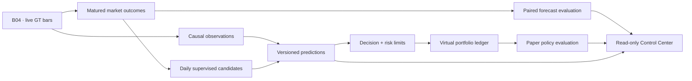

# B07 — первая живая paper/shadow вертикаль Brain

## Решение и план до activation, 2026-10-04

Новое прямое указание пользователя разрешает виртуальную торговлю и делает product loop
приоритетом. Прежний запрет paper заменён; реальные деньги/signing/transactions/paid services
запрещены. F01/D43/holdout неизменны. PumpSwap B06 quarantine не снимается: для раннего
paper используется отдельный exploratory GT price-bar path. Free quota не экономится
ради календарного ожидания; повторно скачивать уже имеющиеся bars ради paper бессмысленно.

B04 остаётся источником12pools/5min, с его quality/actual availability/STOP/expiry. Новый
paper root/runtime/job читает только этот Brain source. Начальный rollout до исходного
expiry2026-10-07T00:30:23.405597Z; остановка/истечение источника видна в Control Center,
новые входы запрещены, stale позиции не закрываются по вымышленной цене. Продление source
и широкий universe — отдельная operational версия; отсутствие недельного data feed не
скрывается семидневным timer. Сегодня цель — работающая вертикаль, не weekly SLA.

Три виртуальных portfolio на один immutable model bundle: empirical/linear/GRU, $1000 каждый,
long-only, $100 entry notional,≤3positions+pending,≤1наpool. Champion empirical прежний;
егоcash — допустимое решение, не принуждать к buy ради демо. Primary horizon15min,
enter если median predicted log return > log(1.016), q10≥−0.25. Фиксированные параметры —
engineering policy, не оптимизированы на paper PnL. Показывать также wait/rejection причины.

Fill model: первая новая закрытая5min candle с close_time>actualdecisiontime и
available_time>decisiontime, полученная с nominal lag≤300s. Нельзя исполниться по цене,
уже известной до решения. TTL entry10min. Market buy/sell reference close, slippage50bps
и fee25bps на сторону; это неподтверждённые assumptions, не venue quotes. $100 notional
плюс entryfee списываются изcash, qty рассчитывается по ухудшенной цене. Time exit заранее
задан при entry: first fresh available close с close_time≥entryclose+15min. Нет intrabar
stop/takeprofit и исполнения по исторически лучшему high/low. Отдельно показывать gross,
net и stress assumptions; mark-to-market не реализованный PnL и может быть stale.

До activation нужны tests causal ordering, restart/idempotency/accounting/limits, source
staleness/quarantine, data-only projection и offline replay. Затем frozen runtime и один
live job без прав реальных транзакций. Никаких исторических paper trades до activation.
Факт live fills/outcomes ждать и проверять; synthetic tests маркировать отдельно.

Candidate refresh: D44/D47/Brain stack, отдельный daily worker≤900s/run, max3runs этого
rollout, четыреfits(linear/GRU,seeds7/19),10epochs, chronological split/purge/train-only scaler.
Первыйrun сейчас по доступному локальномуcorpus; затем≥24h и≥100новыхmature decisions.
Train7day rolling corpus, только matured price targets; paper PnL не ground truth исполнения.
Исходный champion bundle не заменять; новыйbundle получает отдельные candidate books и
future paired forecasts. Автопromotion закрыт; daily forecast/policy summaries показываются.

UI: обнаруженная отдельная control-center ветка — recorded-only observatory. Core публикует
новый whitelist live-paper projection и отдельную рабочую read-only Control Center панель
на loopback; UI не получает raw/weights/credentials/holdout и не запускаетengine. Старую
параллельную ветку не merge/reset; контракт для её интеграции описать в итоговом документе.

После activation завершить actual live observation→prediction→decision→pending→fill→exit
и replay, насколько позволяет рынок (cash не подменять artificial buy). Опубликовать Git,
Memory и адрес открываемого UI; честно отделить работающие части от pending outcomes.

## Поправка перед повторной activation

Первая попытка paper01: paper worker успешно выполнил один tick; training не начался:
существующий D50 child ограничен600s и отклонил900s (`invalid_child_deadline`).
Обнаружен также контракт exclusive log: каждому запуску нужен уникальный log. Новые
B07 jobs остановлены, incident/root/runtime01 сохраняются. Новый paper02/runtime02
с timeout600s (ужесточение первоначальных≤900s), unique logs и отдельным TRAIN_STOP;
ошибка обучения не останавливает paper. Первый failure прекращает свой lane, без retry
loop. Runtime regression tests проверяют повторный запуск и budget. Правила торговли
не изменены, data source B04 не изменён.

## Работающая вертикаль и эксплуатация



B07 — отдельный `memecoin_paper`, не изменение synthetic replay или venue adapters.
Активны три user LaunchAgents `ai.memecoin.brain.b07.paper`, `.train`, `.ui`.
Рабочий root: `work/brain-b07/paper02`, runtime: `work/brain-b07/runtime02`;
pin `ed32c47382e1cc9d0d4fe087ad448e27366fdfce86c0ea8587483484778b0b7c`.
Исходные `paper01/runtime01` сохранены с incident и STOP. B04 не переустановлен.

Открыть **[Live Control Center](http://127.0.0.1:8790)** на этом Mac. Панель показывает
цены/возраст/качество всех 12 pools, прогноз и причину каждого решения, версию модели,
pending/open/closed позиции, virtual cash/equity/fees/PnL, realized результаты по UTC-дням,
paired forecast loss отдельно по 5/15 минутам и статус переобучения. Локальное время в
таблицах берётся из браузера; ежедневные buckets подписаны UTC. Никакой истории до
activation или будущих суток интерфейс не дорисовывает.

Каждый запуск paper сверяет frozen runtime/source binding, читает допустимые raw captures
и фактическое качество, строит последние causal observations, принимает только новые
horizon3 forecasts после activation с задержкой≤120s. После этого восстанавливает ledger
и выполняет детерминированные accounting transitions. Duplicate predictions не создают
повторный order. Ledger commit предшествует обновлению dashboard; crash между ними
устраняется replay. B04 продолжает paired forecasts исходной версии. Новый training bundle
получает отдельный shadow namespace, чтобы результаты разных версий не перезаписывались.

Виртуальный buy: quantity=`100/(reference_price*1.005)`, cash расход=`100.25` USD.
Sell: proceeds=`quantity*reference_price*0.995*0.9975`; net PnL=proceeds−entry cost.
Gross reference return и sensitivity при100/200bps slippage записываются отдельно.
Mark-to-market использует reference price, без будущих exit costs; unrealized/stale mark
не смешивается с реализованным результатом. Fixed-notional policy — первый механический
baseline, не обученный portfolio optimizer/MPC. Исходный forecast15min начинается от
origin свечи; фактическая virtual позиция начинается позже и держится15min от fill-свечи.
Поэтому forecast quality и trading policy quality оцениваются раздельно.

Обучение использует прежний Brain/D44/D47 stack, без изменения backbone, features или
price targets: seven-day rolling snapshot, chrono60/20/20, maturity purge, train-only
scaler; linear/GRU×seeds7/19, width16/context8/10epochs. Первый run завершён на10605matured
samples за59.87s, четыреfits. Membership:4812train/2182validation/3575development-test,
75purged (matured count и split counts различаются из-за purge/unmatured хвоста).
Validation macro pinball empirical0.0121271, linear0.0149007, GRU0.0118750. GRU выбран
только внутри нового development bundle; это не promotion и не устойчивое превосходство.
Новый bundle `dab00e17bd62c7f94916587e91dfe43480aea34717453ecd193f127dbae95018`, исходный
champion bundle `9ea4a6bd7977fb66fe4a18eba54ed7eaed0afd65810ec99c75aec3e1443e3920` неизменен.

Последующие runs: проверка раз в час, не раньше24h после предыдущего и после≥100новых
mature targets; максимум3runs всего. Training cutoff, dataset/model manifests и fit ledger
сохранены. Новый рыночный outcome послеmaturity становится supervised target следующего
snapshot. Paper ledger отдельно оценивает policy/accounting/cost sensitivity; virtual PnL
не выдаётся модели за реальное исполнение и не используется как истинный execution label.
Проверена инфраструктура daily loop; второй календарный training пока не наступил.

### Границы самостоятельной работы

- Deadline600s на training,120s на paper; lock исключает двух writers, lease прекращает
  orphan worker; clock jump/suspend, STOP/expiry и integrity проверяются supervisor.
- Первый paper failure создаёт STOP. Training failure создаёт TRAIN_STOP и сохраняет paper.
  Автоматического retry при таком failure нет. Эти STOP не удалять: новый review/revision.
- Launchd StartInterval30s — запрос расписания, не гарантия частоты завершённых ticks.
  Runs coalesce, worker занимает заметное время; фактические интервалы записаны в evidence.
  Это не realtime per-tick trading. Пропуск/сон Mac не backfill решений.
  Для непрерывной работы компьютер должен оставаться включённым и иметь сеть. Login
  LaunchAgents не являются облачным SLA или системой уведомлений владельцу.
- Исходный source budget12000GET и expiry7октября не продлены; дополнительных provider
  запросов B07 не делает. При отсутствии свежих допустимых цен входы/выходы откладываются;
  source pause отменяет pending. Открытые stale позиции показываются, не «обнуляются».
- Live universe12 включает3quarantined и2valid-stale pools; полный denominator сохранён.
  Не квалифицированы широкий рынок, survivorship-free history и unattended на недели.
- Цена GT — bar proxy с неоднозначными revision/schema семантиками. Fill не подтверждает
  ликвидность/доступность сделки/DEX fees/taxes/MEV/inclusion/rent/price impact/capacity.
  B06 PumpSwap quarantine сохраняется. Реальные wallets/signing/sendTransaction отсутствуют.

### Контракт для отдельной Control Center ветки

`GET /api/snapshot` на loopback8790 — единственная JSON route. `brain-paper-v1` projection
содержит whitelist полей: actual generated/activation/expiry, source freshness, pool prices,
model hashes/candidates, accounting books/signals/positions/closed trades, daily summaries,
paired forecast scores, bounded training summaries, ledger head и virtual-only flags.
Нет raw capture bodies, credentials, model weights, произвольных путей или protected данных.
Нет POST/activation/file API; Host/Origin ограничены localhost, projection экранируется,
cache отключён. Старая recorded-only observatory ветка осталась чистой; её согласованный
read boundary не снят неявно. Новый live-panel можно открыть сразу; перенос этого whitelist
в основной frontend — отдельная UI integration работа, не требующая переписывать Brain.

### Воспроизведение и управление

Из корня проекта, с существующим окружением:

```sh
work/ml-venv/bin/python -c 'from pathlib import Path; from memecoin_paper.runtime import guard; print(guard(Path("work/brain-b07/paper02"))["policy"])'
curl --fail --silent http://127.0.0.1:8790/api/snapshot
launchctl print gui/501/ai.memecoin.brain.b07.paper
```

Replay sealed snapshot выполняется без сети/weights/training:

```python
from pathlib import Path
from memecoin_ml.data import read
from memecoin_registry.contracts import verify
from memecoin_paper.audit import replay
root = Path("work/brain-b07/replay-final")
verify(root)
assert replay(root, read(root / "external-head.json")["ledger_head"]) == read(root / "result.json")
```

Для экстренного прекращения B07 создать **новый** `paper02/STOP` через `publish`, затем
`launchctl bootout gui/501/ai.memecoin.brain.b07.paper` и `.train`. UI можно оставить
для просмотра последнего состояния; B04 не останавливать этой командой. Не запускать
stage-скрипт повторно в существующие roots и не изменять frozen runtime/config.

Desktop UI проверен через Playwright: ошибокJavaScript/горизонтального overflow нет.
На viewport390px JavaScript работает, но есть horizontal overflow; mobile layout не
qualified. Это ограничение первой read-only панели, не изменение торгового runtime.


## Итог живого запуска и решение B07

**Вердикт: ACTIVE_BOUNDED_VIRTUAL_PRICE_PROXY.** Paper/shadow Brain уже запущен,
Control Center работает. Сбор, прогнозы, виртуальная торговля, оценка и ежедневное
обучение кандидатов работают автономно в пределах rollout. Реального execution и
доказательства edge нет. Более точный raw source и обязательная победа GRU больше
не блокируют ранний продукт.

Sealed live slice **2026-10-04 10:41:44–11:01:23 UTC**: 183 решения, два входа, два
выхода, 17 ledger ticks, шесть портфелей. Старый GRU вошёл в DA4pM4xSD… и BeS6PZpnn…;
результаты −$4.050454 и −$0.730165, суммарно **−$4.780619**, комиссии $0.990525.
Остальные пять портфелей выбрали cash; empirical champion сохранён. На cutoff нет
открытых позиций или pending; после cutoff работа продолжается. По этим двум сделкам
и одному короткому режиму рынка нельзя выбирать победившую модель или политику.

| Bundle | Горизонт | Matured n | Empirical pinball | Linear | GRU |
|---|---:|---:|---:|---:|---:|
| 9ea4a6bd… исходный | 5 min | 21 | 0.002758 | 0.019564 | 0.006872 |
| 9ea4a6bd… исходный | 15 min | 7 | 0.004424 | 0.005898 | 0.008251 |
| dab00e17… новый | 5 min | 26 | 0.002432 | 0.010915 | 0.003794 |
| dab00e17… новый | 15 min | 12 | 0.006142 | 0.006261 | 0.005985 |

Сравнения paired внутри каждой строки. Разные моменты активации и наборы наблюдений
не позволяют объявлять межверсионный выигрыш. Есть 66 созревших forecast outcomes;
CI и сравнения по полным дням пока нет. Дневные таблицы будут накапливаться дальше,
без дорисовки paper-истории из backfill.

Проверки: 20 paper tests; 608 базовых PASS / 6 optional skips; 634 combined ML PASS;
check/smoke/build. Независимо сверены 204 market observations с raw, 61 опубликованный
прогноз и две версии моделей. Snapshot manifest:
`c9dd226672a21d4bfece26daec1c73d46b8b13a525308b49894e79ba013b21f1`;
ledger head: `2592a0d04312442109e9fa5a9a48058d24fba8cf733be7a20099b2771bbe053a`.
Source и installed-wheel replay полностью совпали, включая фактические времена
решений/входов/выходов и бухгалтерию. Это 20 минут живой интеграции, а не единственный
тренировочный corpus: обучение использовало 10 605 созревших примеров из семидневного
локального окна.

Зафиксированы 27 запусков paper-worker без ошибок: среднее 14.00 s, максимум 19.48 s.
Фактический интервал стартов — 41.09–50.17 s, среднее 44.56 s. StartInterval=30 s не
означает завершённый tick каждые 30 s. B04 не менялся; в последнем projection 15 476 bars,
дополнительных provider GET для B07 нет. Полный raw scan на каждом проходе остаётся
ограничением масштабирования. Source истекает 7 октября; недельная автономность
пока не квалифицирована.

**Следующий B08:** до expiry подготовить многодневную source/runtime revision и
инкрементальное локальное хранилище; расширять полезную history/universe без повторных
скачиваний. На полных будущих сутках проводить data/features/target ablations с учётом
издержек и задержек. Отдельно согласовать forecast target с задержкой paper fill.
PumpSwap ABI/Token-2022/indexed qualification улучшать параллельно работающему продукту.
Усложнение backbone не приоритет. Для реального исполнения позже нужны проверенный
venue adapter, калибровка затрат/ликвидности/inclusion/failures, независимые ограничения
риска и отдельное явное разрешение владельца.

[Машиночитаемый evidence](evidence/brain-paper-loop-2026-10-04.json) ·
[Wheel/UI verification](evidence/brain-paper-loop-verification-2026-10-04.json) ·
[Первый incident](evidence/brain-b07-first-activation-incident.json) ·
[Скриншот Control Center](evidence/brain-paper-control-center-2026-10-04.png).

Независимая проверка raw → forecast → ledger:

```sh
work/ml-venv/bin/python tools/brain_b07_reproduce.py work/brain-b07/replay-final
```

Raw, ledger и weights находятся в `work/brain-b07/` вне Git. Итоговый report фиксирует
один sealed cutoff; живой dashboard продолжает обновляться. Первая ошибка supervisor
сохранена. Позднее исправлены конфликт имён тестов и неверный импорт offline helper.
Эти инженерные ошибки не вызвали повторных provider requests или реальных транзакций.
