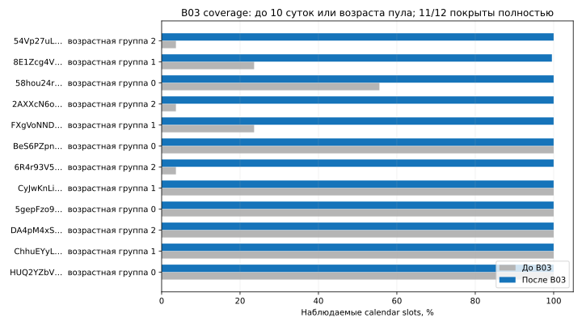
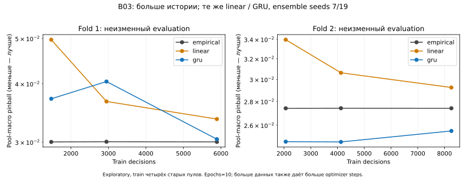

# B03 — quarantine отдельных пулов и возобновление Brain corpus

**Итог: corpus расширен, continuous activation отклонена.** Получено 15 237 bars,
проведены 24 development fits. Два live cycles дали 8/12 и 7/12 свежих пулов при
заранее заданном gate ≥9. Brain collector остановлен; champion не менялся.
[Evidence](evidence/brain-pool-quality-2026-10-04.json). Ниже сохранён исходный план,
затем приведены результаты, графики и решение по B04.

## План до новых запросов — 2026-10-04

B02 принят пользователем. B03 меняет обработку известного data-quality failure,
не scientific правила F01, universe, исходные bars/features/targets или модели.
Старые B01/B02 STOP, failed runs и raw неизменны. Новое самостоятельное решение
об activation возможно только после fixtures, recorded replay и проверки bindings.

Исходные bounds: expiry 2026-10-07T00:30:23.405597Z, 12000 GET суммарно с B01/B02,
103 уже израсходованы; paid0, тот же public keyless GeckoTerminal. 12 исходных пулов
всегда в denominator. Импорт raw/model/shadow byte-for-byte, исходные receipt times.
Смена протокола failure classification явная: прежние конфликты OHLCV переводятся
в pool quarantine, а не обнуляются как будто успешные; это разрешённый B03 repair.

Правила pool quality:
- Только известные strict bar errors: duplicate timestamp, invalid OHLCV, alignment.
  Весь ответ исключается. Никакого выбора одного conflicting duplicate/слияния OHLCV.
- Quarantine durable до следующего GET. Проблемный HUQ… seeded из B02 raw evidence.
  Остальные пулы продолжают; в каждом cycle для всех12 есть observed/skipped/failure status.
- Не более одного recovery probe в час, максимум3 на pool до исходного expiry.
  Для release нужны2 consecutive свежих valid probes, разделённых не менее1часа.
  Probe bytes сохраняются; пока pool quarantined, новые shadow predictions по нему
  не выдаются. Уже выпущенные forecasts могут получать mature outcomes по valid raw.
- При4 quarantined pools (из12) global quality stop; не продолжать выборку из меньшинства.
  Fresh здесь nominal close age≤600s; shadow по-прежнему использует свой≤300s gate.
- HTTP/auth/rate/network, hash/clock/runtime corruption не являются pool errors.
  Auth/429 немедленно закрывают источник; transport закрывает cycle,2 consecutive
  global failures→STOP. Integrity/runtime failure→STOP. No immediate retry/catchup.
  Успешный cycle без новых запросов не сбрасывает global failure debt.

Qualification: свойства на fixtures, полный mixed healthy/quarantined cycle, restart,
recovery spacing/count/release, provider failure, crash reservation, denominator,
future input/target, recorded conflicting response и exact replay. Staged runtime
с code/config/universe/import/quality-seed bindings; hard240s collection/600s training,
CPU1 для fit, существующие6h/max12training cycles, leases/STOP/disk/clock safeguards.

После qualification — один новый approved root work/brain-b03/prospective01. До
установки job выполнить bounded live cycle, исторический проход максимум24GET/600s
по недобранным prefixes шести пулов до B02 anchor/floors, затем второй due cycle.
History request before=cursor−1; общий pacing≥12s, единый root/lock/request counter.
Historical pass не повторяется после failure/crash; schema failure quarantines pool,
provider failure закрывает pass и runtime. Ни одного дополнительного источника.
Два live cycles должны сохранить полный denominator и дать≥9 fresh valid pools;
иначе service не устанавливать. Никакого третьего live qualification retry.

Сохранить coverage/revision/paired mature shadow report и wheel reproduction. Если
история существенно расширит pool diversity, повторить B02 learning curves на новом
sealed dataset: те же2folds×3sizes×4fits=24, hard600s, без изменения champion и без
выбора lucky seed/horizon. Robust normalization — отдельный следующий experiment,
не смешивать с качеством/объёмом данных в B03. Календарные часы/дни накапливает bounded
job; не объявлять их полученными заранее. Trading/paper/live/RL запрещены.

Recorded refinement до GET: полный B02 raw inventory выявил два конфликтующих пула,
HUQ… и5gep…, а не только HUQ. Первый offline qualifier ожидал ровно1 и остановился
до создания fixture root/сети. Seed берётся из всех установленных unresolved schema
failures; два пула quarantined, denominator12 и global stop при4 не меняются.

Training gate уточнён до activation: B01 model уже старше6h. Новый runtime не запускает
refresh во время live qualification; нужен отдельный immutable qualified.json после
двух успешных due cycles. Затем прежний6h/max12cycle protocol работает на расширенном
corpus. Никаких новых backbone/targets; initial service fit учитывается отдельно отcurves.

## Результат B03 — 2026-10-04

**Engineering isolation работает; continuous activation ОТКЛОНЕНА.** Два разрешённых
live cycles дали8/12 и7/12 fresh valid pools при frozen gate≥9. Третий cycle не запускался,
service не установлен, `qualified.json` не создан, automatic refresh не выполнялся.
Новый root закрыт `STOP: live_qualification_freshness_gate_failed`. Старые STOP не сняты.
Ни один Brain LaunchAgent сейчас не loaded; фонового накопления Brain corpus нет.
Это завершённое решение по candidate, не успешная activation и не ожидание F01.

План12583b0, runtime5c0cf67, offline tools32b36e5. Новый `memecoin_brain_quality`
сохраняет hash-linked quarantine/probe ledger, полный denominator12, no-retry/due-only
scheduler и global provider/integrity stops. В shared shadow добавлен только optional
prediction-pool filter; старые frozen bundles, модели, bars/features/targets не менялись.
Recovery release проверен на fixtures, **реальных часовых probes/release ещё нет**.

Recorded replay12пулов:10valid+2conflicts, network0/fit0. Seed уточнён по полному raw
inventory: B02captures000088(5gep…) и000101(HUQ…) конфликтуют. First preflight, ошибочно
ожидавший один конфликт, остановился offline; история сохранена. Это уточнение до GET.

Реальные bounded фазы:

| Фаза | GET | Результат |
|---|---:|---|
| Cycle1791100800 | 10 | 110,61s; fresh8, stale2, quarantine skipped2;14new forecasts |
| Historical pass | 12 | 133,48s; все6недостающих prefixes достигли frozen floor |
| Cycle1791101100 | 10 | fresh7, stale2, new quarantine1, skipped2;12new forecasts |

Во втором cycle capture000129(FXgVoNND…) вернул `duplicate_bar_in_response`.
Raw сохранён целиком, ответ исключён, pool quarantined, остальные запросы продолжились.
Quarantined теперь3/12; global quality threshold4не достигнут. Новый provider/auth/rate/
transport failure0. Первая freshness assertion не прошла; исторический проход был
отдельно разрешён планом и выполнен без попытки установить service/разрешить refresh.

У58hou… последний nominal close отстал на9835→10282s, у8E1… на3547→3994s.
Причина не установлена: `include_empty_intervals=false` само по себе не доказывает ни
отсутствие торгов, ни сбой provider. Stale бары не объявлены свежими, прошлые gaps не
стали online observations. Shadow по-прежнему требует исходную freshness≤300s.

ВсегоB03 **32GET**, общий debitB01–B03/probe **135/12000**, paid/Alchemy/QuickNode/trades0.
Минимальный измеренный start spacing12,018s. Новые request artifacts1,326MB.
Expiry остался2026-10-07T00:30:23.405597Z; новая72hкампания не открыта. Runtime pin:
`0119e651fec62f642a82042a5d078cbb69ec9ca5c3dddab57c2f282ac9b6a9b4`.
Окончательное решение `work/brain-b03/final-activation-decision.json` заменяет только
qualification-phase разрешение, не переписывает его.

## Coverage, revisions и sampling bias

Sealed snapshot `work/brain-b03/snapshot01`, as-of2026-10-04T08:12:21.712272Z:
**4 853→15 237 unique bars**,12pools. В common10day dataset14 433bars/14 326decisions,
52censored targets. Historical prefixes завершены у12/12, calendar slots полностью
покрыты у11/12; у8E1… отсутствуют2из445интервалов (99,55%). Полнота prefix не доказывает
полноту market history. Никакой интерполяции/forward-fill пропущенных targets.

Largest-pool share62,04%→20,90%; train обоих folds теперь4старыхпула вместо1.
Возрастная, current-ranking, survivorship и liquidity selection сохраняются; quarantine
добавляет зависимость наблюдаемости от качества source. Valid исторические captures
quarantined pools остаются с provenance; malformed responses исключаются целиком.
84revision observations/69unique keys, close revisions4. First-observed version merge,
raw/receipt/available timestamps неизменны. Historical downloads не backdate доступность.

Receipt support расширился с2до3UTCчасов **одного дня**, это не continuous coverage
нескольких дней. Две короткие prospective фазы не закрывают календарный пробел междуB02
иB03; historical timestamps описывают event time, не время успешного сбора.

## Learning curves и paired shadow

24real development fits за64,01s при600s hard cap, CPU1, seeds7/19,10epochs;
empirical/linear/GRU без новых backbone/targets. Те жеB02правила global chronological
folds, horizon purge и nested25/50/100%train; validation/evaluation неизменны внутриfold.
Новые cutoffs выведены из нового sealed dataset, поэтому абсолютныеB02/B03scores
нельзя сравнивать как один matched test. Эти evaluation данные exploratory, не F01.

Pool-macro pinball, меньше лучше; neural columns — ensemble обоих seeds:

| Fold | Train decisions | Empirical | Linear | GRU |
|---|---:|---:|---:|---:|
| 1 | 1476 | 0,030021 | 0,049686 | 0,037137 |
| 1 | 2948 | 0,030049 | 0,036645 | 0,040429 |
| 1 | 5892 | 0,030028 | 0,033601 | 0,030428 |
| 2 | 2064 | 0,027404 | 0,033953 | 0,024694 |
| 2 | 4128 | 0,027411 | 0,030618 | 0,024674 |
| 2 | 8256 | 0,027408 | 0,029245 | 0,025534 |

Полный GRU train: improvement−1,33%/+6,84%; exploratory paired1h-bootstrap CI
[−24,77%;14,09%]/[1,02%;13,50%],200draws,seed20261004. Во второмfold есть положительный
сигнал, но он не монотонен по размеру данных, в первомfold не воспроизводится,
seed7наfulltrain хужеempirical в обоихfolds. Folds перекрываются; epoch budget fixed,
optimizer steps растут сданными. Это не устойчивое превосходство модели.

Shadow относится к неизменномуB01model000000, **не к новым curve checkpoints**.
170forecasts,151published outcomes:145scored+6censored,19pending; offline recovery0
в этомsnapshot. Все3кандидата на одинаковых future observations послеmaturity.
Pool-macro empirical/GRU/linear **0,005534 / 0,006684 / 0,013963**; GRUхуже20,8%.
ДваUTC-hour clusters→CIне выдаётся. Horizon15min частично лучше уGRU,5minхуже;
это не основание выбирать удачный horizon. Quarantined pools не получают новых
forecasts, ранее опубликованные могут получить mature outcome по valid raw.

Max evaluation feature |z|=1425,58 для`lower_wick` относительно train-only scaler.
Data diversity улучшилась, но tail/distribution/source-quality проблема осталась.
Championempirical не заменён, curve checkpoints не опубликованы в runtime.

## Проверки, воспроизведение и следующий этап

16 новых substantive tests: mixed full cycle/restart, probe spacing/count/crash,
provider401/403/429, ledger/hash integrity, denominator, global stop, historical
pagination/no progress/future page, filtering всехтрёх shadow candidates доinference.
548 base/5 optional skips,573 combined tests; Ruff/format/mypy существующегоstrict scope,
smoke/build. Installed wheel воспроизвёл raw→dataset, folds, empirical baseline,
24checkpoints→six ensemble predictions, metrics/bootstrap и mature shadow **exact**;
reproductionfit0/network0. Все imported raw иparentSTOP hashes совпали; D50bundle
проверен. D43/F01/reserved raw не открывались и не менялись.

**B04:** source availability/freshness audit и аудит экстремальных candles/features;
затем заранее ограниченная train-only robust-normalization ablation при прежних
моделях/targets. Для возобновления prospective сборa нужен отдельный collector-only
контракт: измерять source health, pool inactivity/unknown и допустимость forecast
раздельно, сохраняя всех12пулов и все пропуски. Его нельзя задним числом выдать за
успехB03 или просто снизить≥9до текущих7; до нового конкретного решения jobнеустановлен.
Не увеличивать backbone по одному выигравшемуfold, не продлевать budgetмолчаливо.

[Итоговое evidence](evidence/brain-pool-quality-2026-10-04.json) содержит exact hashes,
paths, cutoffs/membership, seeds, scores, ledger heads и operational решение.
Локальные raw/weights: `work/brain-b03/`; read-only status:
` .venv/bin/python -B tools/brain_status.py --root work/brain-b03/prospective01 `.
