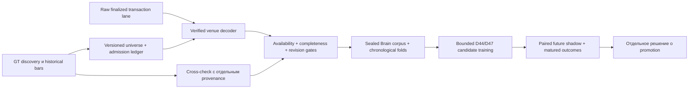

# B05 — источники и устойчивость Brain перед масштабированием

## План до новых runtime RPC — 2026-10-04

Пользователь изменил приоритет: сначала source architecture и unattended reliability,
а не очередной model experiment. B04 frozen collector продолжает работать в своём
исходном envelope; его runtime/STOP/retry правила не меняются. F01/D43/holdout закрыты.
Новых fits и model promotion в B05 не планируется. Linear-winsor остаётся кандидатом.

Сначала read-only audit B04 cycles/quarantine/revisions/coverage и действующих источников.
Затем изолированная diagnostic raw lane: finalized Alchemy HTTP, один getMultipleAccounts
для owner inventory всех12Brain pools, два signature pages(limit20) для четырёх заранее
выбранных адресов: stale58hou…, stale8E1…, ambiguousFXg… и первый healthyChhu….
Для каждого — максимум один getTransaction последней successful signature. Не искать
более «удобные» адреса/transactions при пустом/null ответе. До13RPC/500nominalCU,
hard180s,timeout10s,max1MiB/response,≥1s spacing; первый source/integrity error→STOP,
без retry или второго candidate. Raw/actual request/receipt/available times immutable.
У всех diagnostic данных historical availability unknown; ingestion не создаёт прошлый
online state. Account references не равны swaps; balances не заменяют venue decoder.

Это новая отдельная B05 allocation≤500CU/USD0 в рамках автономного read-only Brain
research, **не reuse D51 receipt/allocation**. Основание no-paid: owner attestation этого
же аккаунта/noPAYG/no card/30M, сверка credential fingerprint, свежий MCP usage8020CU/USD0
(dataThrough09:04UTC). Usage ранее был немонотонным: не использовать delta как measured
charge и не считать MCP доказательством Dashboard plan. При несовпадении credential,
исчезновении локального доступа или сомнении no-charge — runtime probe не проводить.
Никаких subscriptions, upgrades, trial enrollment, paid streaming или торговых RPC.

Результат probe не заменяет collector: показать activity/metadata coverage и реальные
границы semantics. Нужен provider-neutral append-only event evidence contract с actual
availability, duplicate/revision handling, account-reference versus decoded-trade gates,
bounded pagination/gaps, source-local health decisions и независимым fatal integrity.
Проверить fixtures, recorded/live offline reproduction и wheel. Не объявлять просто
новый vendor primary без verified venue decoding и prospective coverage evidence.

Рассчитать capacity/budget для12/100/300pools с явными предположениями; отличать HTTP
metadata/control от массового transaction data plane. Официальные Alchemy/Solana/Helius
документы проверить; Helius рассматривать как candidate, доступ/оплату не предполагать.
Итог: решение о роли GeckoTerminal и raw lane, конкретный следующий этап, Memory/Git.

## Итог B05

**Принять разделённую source architecture. Не масштабировать GeckoTerminal как
единственный основной источник; не заменять работающий B04 непроверенным raw collector.**
GeckoTerminal сохраняет роли discovery, historical bootstrap и независимого bar cross-check.
Для нового основного потока рассматриваем finalized raw transactions с собственным venue
decoder и проверяемыми границами покрытия. Провайдер не зафиксирован; Alchemy — реально
доступный read-only источник для следующей bounded квалификации. WSS off из D40-v2
сохраняется; transport tuning не возобновлялся.

Это продвижение data foundation, **не готовая unattended Brain на сотнях токенов**.
В B05 нет новых fits, новых deployed weights, model promotion или доказательства edge.
Linear-winsor challenger отложен по новому приоритету пользователя, не отклонён научно.
D43/F01/holdout не читались и не менялись; их gate не блокирует Brain Development.

## Реальный source probe

План зафиксирован до runtime RPC: `fba806a`, raw code `0c9af4b`, launcher `3f3dbdb`.
Одна попытка `work/brain-b05/raw01`: **13/13 RPC, 500/500 nominal CU, 12,34s subprocess**,
HTTP failures0, retries0. 1 owner inventory + 8 signature pages + 4 transaction hydrations.
160054 bytes response bodies, 236096 bytes всего sealed artifact — размер этой выборки,
не оценка длительного bandwidth/storage. USD0/no-charge основаны на owner attestation
и прежнем credential mapping; это не независимая provider billing verification. MCP usage
8020CU/USD0 с freshness09:04UTC записан в binding, не использован как измеренная дельта.
Новая B05 allocation500CU отделена от использованной D51 allocation3600CU. Long-running
Alchemy job/subscription не создавались. Helius runtime access не проверялся.

Owner inventory: 9/12 принадлежат PumpSwap
`pAMMBay6oceH9fJKBRHGP5D4bD4sWpmSwMn52FMfXEA`, что совпадает с
[официальным program ID](https://github.com/pump-fun/pump-public-docs/blob/main/docs/PUMP_SWAP_README.md).
Остальные три имеют отличающиеся owners; GT классифицирует их как Orca, Raydium CLMM,
Meteora. Существующий Raydium CPMM decoder не распространяется на эти пулы автоматически,
даже если другой AMM тоже использует constant-product формулу. dataSlice length0 дал
только metadata: это **не strict coherent pool checkpoint**.

Во всех четырёх cohort pools вернулось по40 account references; вторые страницы полные,
то есть truncation известна и history_complete=false. 157 successful/3 failed references,
выбраны четыре latest-successful transaction по заранее заданному правилу. Три version0,
одна legacy; null0. Offline проверены signature, slot и pool membership в accountKeys.
Instruction labels Buy/Sell/Swap присутствуют, но не заменяют проверенный decoder,
атрибуцию CPI, amounts/mints/decimals/fees или реконструкцию исполнения.

| Заранее выбранный pool | Последнее reference blockTime (UTC) | Последний допустимый GT bar перед probe, open (UTC) | Вывод |
|---|---|---|---|
| stale58hou… | 05:17:01 | 05:15:00 | Reference внутри того же5min bar; stale не доказывает GT lag |
| stale8E1… | 07:04:12 | 07:00:00 | То же; редкая активность совместима с evidence |
| quarantinedFXg… | 08:49:00 | 2026-10-03 16:40:00 | Старый valid response; новые malformed ответы исключены, не честное измерение provider latency |
| healthyChhu… | 09:10:52 | 09:05:00 | Новый reference после старта probe; разные моменты выборки, не latency race |

GT captures stale-пулов получены за190/178s до начала probe09:10:45UTC. Их последние
nominal closes старше на3,85/2,10h, а последние references — на3,90/2,11h. Поэтому прежний
вывод «причина stale неизвестна» уточняется: bounded independent evidence **совместим с
низкой активностью**, но не доказывает отсутствие всех сделок. Для FXg valid probe09:11
появился уже после начала Alchemy probe, его нельзя подставить в первоначальное сравнение.
У Chhu 40references покрывают лишь51s; лимит40 не покрывает даже один5min polling interval.
В audit `newest_reference_age_seconds` отсчитан от общего начала probe; значение−6,90s
для Chhu означает появление события во время последовательной проверки, не clock failure.

Стандартный [getSignaturesForAddress](https://solana.com/docs/rpc/http/getsignaturesforaddress)
возвращает newest-first references к адресу в accountKeys, не все swaps токена.
minContextSlot — fence контекста узла, не нижняя граница event history.
[getTransaction](https://solana.com/docs/rpc/http/gettransaction) может вернуть null;
blockTime/meta могут отсутствовать. Нельзя объявлять HTTP универсальным восстановлением
истории или восстановленную запись доступной online в её blockTime.

## B04: устойчивость и corpus

Работающий collector/runtime/activation/budget не менялись. Read-only handoff09:18:53UTC:
STOPнет, общий debit203/12000,268forecast variants,234scored/6censored/28pending.
launchd job loaded, last exit0; между due cycles процесс может быть `not running`.
Expiry прежний **2026-10-07T00:30:23.405597Z**; awake/login/network необходимы.

Один cycle1791104100 завершился через28,15s ошибкой:

```json
{"category":"public_http_failure","error_type":"URLError","http_status":null,"no_retry":true}
```

Категория transport; DNS/TLS/timeout subtype неизвестен по исходному логу. Следующий due
cycle1791104400 completed107,78s; после него ещё три completed. Старые429/URLError из B01
в inherited requests сохранены, не приписываются новым B04cycles. Первые3hourly probes:
HUQ capture000172 снова `duplicate_bar_in_response`;5gep/FXg valid-stale. Все остались
quarantined, counters1/3, streak0; release не происходил. Новое schema событие осталось
локальным, остальные пулы собирались. Global q≥4/auth/rate/2consecutive transport/
integrity/6no-progress guard не ослаблен и не обещает бесконечного uptime.

Отдельный sealed bar snapshot **09:14:00.701941UTC**, а не плавающий handoff:
15323bars/12pools;128revision observations/98keys, из них6close revisions;4quarantined
captures. Receipt support4UTC-hour buckets **одного дня**, не4полных часа непрерывного
наблюдения. Исторический calendar coverage11/12 по прежнему anchor не означает fresh
prospective completeness. Ranked/liquidity/survivorship bias и unseen deaths сохраняются.

Paired shadow старого model000000:254forecasts,220scored/6censored/28pending;
3hour blocks, CIне вычислялся. Pool-macro pinball (меньше лучше):

| empirical | GRU | linear |
|---:|---:|---:|
| 0,006990 | 0,008152 | 0,015251 |

Raw→mature outcomes reproduction exact; champion empirical прежний. Независимых суток
и разнообразия режимов недостаточно. Снимок exploratory; не выбирать модель по одному
часу/горизонту, где GRU локально лучше. Новых learning curves в B05 нет; B03/B04 curves
и их отрицательные/смешанные результаты сохранены без переобучения.

## Почему не просто увеличить число pools

Расчётная схема: GT один GET/pool/300s, pacing12s; Alchemy один signatures poll/pool/300s
по40CU и1hydration/min/pool по40CU. Это **сценарий**, не измеренный traffic; pagination,
повторная доставка, recovery и другой account usage добавят расходы. Тарифы проверены
по [официальной таблице Alchemy](https://www.alchemy.com/docs/reference/compute-unit-costs):
getMultipleAccounts20, getSignaturesForAddress40, getTransaction40CU; batch не бесплатен.

| Pools | GT GET/day | Serial cycle при12s | Alchemy nominal CU/30days |
|---:|---:|---:|---:|
| 12 | 3456 | 144s | 24 883 200 |
| 100 | 28800 | 1200s | 207 360 000 |
| 300 | 86400 | 3600s | 622 080 000 |

При public GT pacing12s теоретически максимум25pools/5min без запаса; текущий240s deadline
ещё строже. Официальные [GT docs](https://api.geckoterminal.com/docs/v2/swagger.json)
описывают beta/cache60s и приблизительный изменяемый rate limit, не SLA. Наивный polling
100/300 несовместим с cadence и нынешним бюджетом. На Alchemy даже условные12пулов почти
съедают30M/месяц; фактический healthy sample существенно плотнее1tx/min. Нельзя переносить
этот единичный плотный sample на весь рынок, но он показывает опасность фиксированных pages.

[Alchemy getTransactionsForAddress](https://www.alchemy.com/docs/chains/solana/solana-api-endpoints/get-transactions-for-address)
— кандидат indexed batching; advertised pagination/response limits и цена100CU ещё не
доказывают доступность, completeness или фактическую стоимость полезного события у нас.
**В B05 не вызывался.** Альтернатива — filtered transaction streaming с replay, не склейка
account notifications в псевдоатомарное состояние. [Helius LaserStream docs](https://www.helius.dev/docs/laserstream)
описывают48h replay, at-least-once delivery и Mainnet Business/Professional requirement;
у WebSocket replay отсутствует. Доступ/стоимость нашего аккаунта неизвестны, paid
подключение не разрешено; маркетинговые страницы с другими retention цифрами не контракт.
Ни один vendor пока не выбран как безусловная долгосрочная зависимость.

## Что реализовано и что ещё требуется

Новый отдельный `memecoin_brain_sources` не меняет frozen collectors, CPMM, features,
targets или старые outputs. Append-only evidence ledger сохраняет provider/network/signature,
raw manifest и semantic hash, actual receipt/availability, локальную first admission.
Duplicate не создаёт новую семантику; изменённый finalized payload → revision quarantine;
null/unsupported не мешает будущей hydration, но не переносит availability назад.
As-of view не видит будущие revisions. Все account-reference entries training_eligible=false.

Raw pilot резервирует CU до сети, сохраняет capture до разбора, stops на первой ошибке,
имеет внешний180s watchdog и одноразовый root. Pagination ограничена двумя pages;
unknown gaps остаются unknown, не zero-volume bars. Restart ledger проверяется, но raw
probe намеренно не возобновляется и не является continuous collector. Capture sealing/
хэширование выявляет изменение; полная power-loss durability raw payload ещё не доказана.

`health_action` задаёт границы будущего supervisor: schema/protocol/revision — provider+pool;
auth/rate — provider; transport — bounded cooldown; hash/clock/budget — global fatal.
**Это policy function, не уже развёрнутый multilane circuit breaker.** Автоматическое
переключение источника не должно подменять идентичность prices/features или скрывать gaps.

Будущая последовательность допуска данных и моделей:



До долгого unattended режима нужны durable cursors/gap debt/backpressure, source-local
circuit breakers с исчерпаемым recovery budget, ежедневная quota/disk/heartbeat accounting,
versioned universe admission с delist/death retention, отдельная qualification каждого
venue и экономичная event ingestion. Data qualification должна управлять training trigger;
календарный timer сам по себе не допускает fit. При плохих данных collector пишет
missingness, trainer пропускает запуск, champion не меняется. Model selection остаётся
chronological/paired и отделённым от exploratory F01-independent разработки.

## Проверки и воспроизведение

8новых substantive tests: duplicate/restart/revision/as-of/provider identity,
null→hydration causal availability, hash corruption, no-retry debit, nonprogress cursor,
future receipt rejection, raw→replay и capacity. `make check`:565passed/6optional skips;
ML environment591passed, `make smoke`, wheel build прошли. Installed wheel независимо
восстановил inventory/pages/transactions/ledger view и quota exact, network0/fits0.
Frozen B04 и D50 проверены без открытия protected data. Replay code `08fbced` появился
после sealed live capture; source pin acquisition `0c9af4b` не переписан задним числом.

История инженерных ошибок сохранена: первоначальный fixture overwrite, pytest basename
collision и неверный аргумент ручной runtime проверки; исправлены без новых source RPC.
Их логи находятся в `work/brain-b05/`; это не provider failures. Source replay проверяет
внешний manifest pin, receipt clocks, запросы/резервирования и payload relationships.

```sh
.venv/bin/python -B -m memecoin_brain_sources.replay \
  work/brain-b05/raw01 \
  088d61f3ec317f13cdffa61451f3dd95f5372c07e0da8b4f273bdc6347eeb9f4 \
  work/brain-b05/new-offline-result.json
.venv/bin/python -B tools/brain_status.py --root work/brain-b04/prospective01
```

Не повторять live launcher: raw01/binding/allocation уже использованы. Новому probe нужны
свой immutable plan/root/budget review. Raw данные вне Git, path+hash в
[итоговом evidence](evidence/brain-source-architecture-2026-10-04.json).

## Следующий оптимальный этап — B06

**PumpSwap event decoder и экономичный bounded raw ingestion**, а не новый backbone.
Причина выбора venue —9/12 реально проверенных owners и все4diagnostic pools. Зафиксировать
официальный IDL/program scope; сверить buy/sell/CPI, token programs, decimals, fee transfers,
failed transactions и неизвестные инструкции на fixtures и этих recorded transactions.
Это не разрешение переписать Raydium CPMM или молча включить другие venues.

После offline semantics — новый ограниченный paired prospective опыт: проверить доступность
indexed/batched transaction source, стоимость useful decoded event, cursor catch-up/gaps и
local failure isolation. Сохранять route attribution и cross-check GT отдельно. Допуск
расширения universe определяется coverage/completeness/стоимостью, не желаемыми100–300
токенами. B04 продолжает накопление до исходного stop/expiry. Уже затем — подключение
qualified нового corpus к D44/D47 training и заранее ограниченный будущий model challenge.
